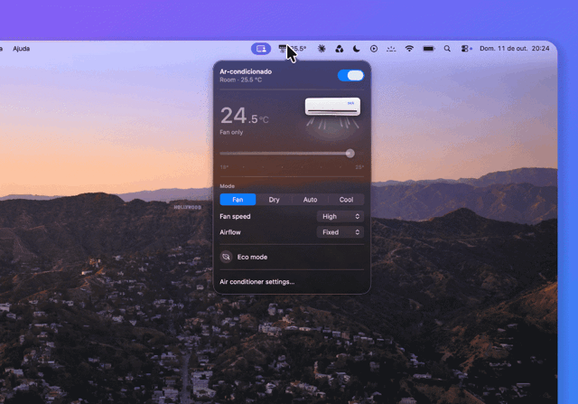

# Celsius

[](https://github.com/gbvillarinho/celsius/releases/latest)
[](https://github.com/gbvillarinho/celsius/releases)
[](https://github.com/gbvillarinho/celsius/actions/workflows/release.yml)
[](LICENSE)


[](https://github.com/gbvillarinho/celsius/stargazers)
[](https://github.com/gbvillarinho/celsius/commits/main)

Control your air conditioner from the Mac menu bar. Click the icon, pick a temperature, mode or fan
speed, and that's it. No phone needed.

> **This is a fork for Midea / Springer Midea air conditioners.** It talks to the unit directly on your
> local network (no cloud after setup), using the Midea LAN protocol ported from
> [msmart-ng](https://github.com/mill1000/midea-msmart). It was built and tested with a Springer Midea
> 42AFVCI09S5. The original [Celsius](https://github.com/gbvillarinho/celsius) controls LG ThinQ units.

<p align="center">
  
</p>

## What it does

- Turns the air conditioner on and off
- Changes the mode (cool, fan, dry, auto)
- Sets the temperature, with a range you choose
- Sets the fan speed and the air swing
- Turns Eco mode on and off
- Sets a sleep timer that turns the unit off after a few hours (kept by the app: this unit ignores
  timers sent over the network, so the Mac must be awake when the time comes)
- Opens when you log in, if you want it to

## What you need

- A Mac running macOS 15 or later, on the same network as the air conditioner
- A Midea / Springer Midea air conditioner with Wi-Fi that already works in the MSmartHome app
- The unit's token and key (see below)

## Connect your air conditioner

Units with protocol V3 need a token and key that the Midea cloud hands out once. Get them with
[msmart-ng](https://github.com/mill1000/midea-msmart), using the account from the MSmartHome app:

```sh
pip install msmart-ng
msmart-ng discover --account you@example.com --password '…' <unit IP>
```

If your account is from MSmartHome and the login fails with "password error", msmart-ng's `discover` is
logging in to the NetHome Plus servers. Point it at the MSmartHome servers instead:

```sh
python -c 'import sys, msmart.discover as d, msmart.cloud as c; d.NetHomePlusCloud = c.SmartHomeCloud; \
from msmart.cli import main; sys.argv = ["msmart-ng"] + sys.argv[1:]; main()' \
  discover --account you@example.com --password '…' <unit IP>
```

Copy the `Found device` line (`{'ip': …, 'id': …, 'token': …, 'key': …}`), click the Celsius icon, paste
it in Settings and click Connect. The details are stored in your Mac's Keychain. Give the unit a fixed IP
in your router so it doesn't move.

The first time, macOS asks to let Celsius find devices on your local network. Click Allow.

## Install

This fork has no prebuilt release. Build it from source (you need the Command Line Tools,
`xcode-select --install`):

```sh
git clone <this repository> celsius
cd celsius
scripts/build-app.sh --install
```

That builds the app, copies it to Applications and opens it. Its icon shows up in the menu bar.

## Updating

The update check is off in this fork, because upstream releases are the LG build. Pull this repository
and run `scripts/build-app.sh --install` again.

## Questions

**"Can't reach the air conditioner."**
The Mac and the unit must be on the same network, and the unit's IP must not have changed. Check the IP
in your router (or run `msmart-ng discover` again) and paste the new details in Settings.

**"The air conditioner refused this token and key."**
Get them again with msmart-ng and paste them in Settings.

**Does it work with any Midea unit?**
It was built and tested with one model (Springer Midea 42AFVCI09S5). Other Midea units with protocol V3
should work, but some controls may be missing or behave differently.

---

## For developers

Celsius is a Swift Package (no Xcode project). You only need the Command Line Tools
(`xcode-select --install`) and Swift 6.2 or later.

Build and install from source:

```sh
git clone https://github.com/gbvillarinho/celsius.git
cd celsius
scripts/build-app.sh --install    # build, ad-hoc sign, copy to /Applications and launch
```

Use `scripts/build-app.sh` without `--install` to only build `build/Celsius.app`. To install with the
unit's details already in the Keychain: `CELSIUS_MIDEA=path/to/midea.json scripts/build-app.sh --install`.

Build and test:

```sh
swift build                           # debug build
scripts/test.sh                       # all tests
scripts/test.sh --filter StoreTests   # one suite
```

Always run tests through `scripts/test.sh`. With only Command Line Tools installed, Swift Testing lives
outside the default search paths, and the script adds the flags it needs.

Environment variables for running from the terminal:

| Variable | Effect |
| --- | --- |
| `CELSIUS_MIDEA=<json or file>` | use these unit details instead of the Keychain |
| `CELSIUS_OPEN_ON_LAUNCH=1` | open the popover on launch |
| `CELSIUS_LIVE_SNAPSHOT=<file.png>` | render the popover with live data once it loads |

To check UI changes without running the app, render the popover in fixed states (no network):

```sh
$(swift build --show-bin-path)/Celsius --snapshot <dir>
```

Layout:

- `Sources/CelsiusCore`: API client, models, settings/Keychain and the observable store (tested)
- `Sources/Celsius`: the AppKit + SwiftUI app (status item, popover and views)
- `Tests/CelsiusCoreTests`: Swift Testing suites; fixtures are real responses from the unit, with the device ID replaced

The app talks to the unit over the Midea LAN protocol (TCP port 6444, protocol V3). Run
`$(swift build --show-bin-path)/Celsius --probe` to read the unit once from the terminal. See
[CLAUDE.md](CLAUDE.md) for architecture details and conventions.

## License

[MIT](LICENSE). Celsius is not affiliated with or endorsed by LG Electronics, Midea or Springer.
